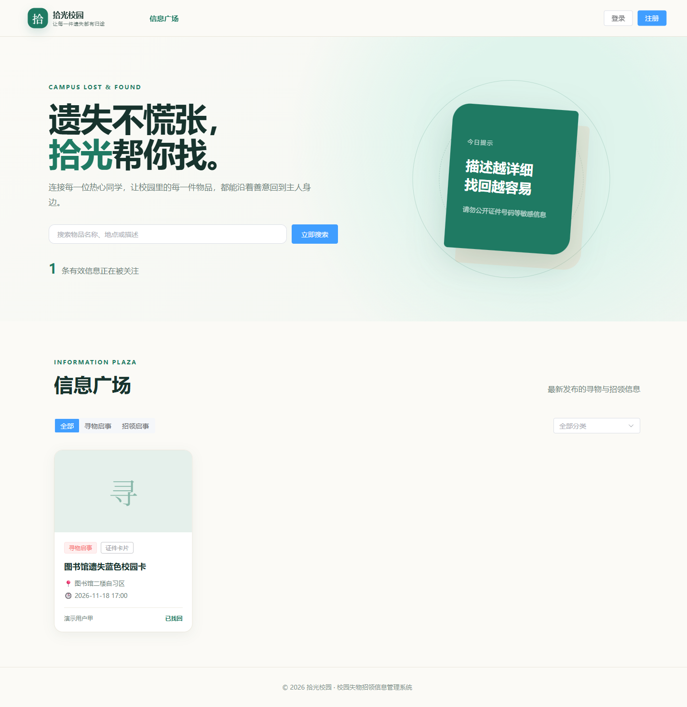

# 拾光校园——校园失物招领信息管理系统

基于 Spring Boot、Vue 3 和 MySQL 的前后端分离毕业设计项目。系统围绕“发布、审核、检索、认领、确认归还”形成完整业务闭环，并提供站内通知、后台统计和操作日志。



## 已实现功能

- 用户注册、登录和 JWT 身份认证
- 寻物启事、招领启事发布及管理员审核
- 关键字、信息类型和物品分类组合检索
- 认领留言、发布者处理申请和确认归还
- 我的发布、我的申请、收到的申请和站内通知
- 管理后台统计、待审核列表和操作日志
- 中文响应提示、参数校验及统一异常处理
- 响应式中文界面，支持电脑和手机访问

## 技术栈

- 后端：Java 17、Spring Boot 3.5、Spring Security、Spring Data JPA、JWT、Maven
- 前端：Vue 3、TypeScript、Vite、Pinia、Vue Router、Axios、Element Plus
- 数据库：MySQL 8；自动化测试使用 H2

## 目录结构

```text
├─ backend/                  Spring Boot 后端
├─ frontend/                 Vue 3 前端
├─ database/                 MySQL 建表与检查脚本
├─ docs/                     接口、数据库设计、验收报告和截图
├─ .env.example              环境变量示例
└─ README.md
```

## 环境要求

- JDK 17
- Maven 3.8 或更高版本
- Node.js 22 或更高版本及 npm
- MySQL 8.0 或更高版本

## 本地运行

以下命令均从仓库根目录执行。

### 1. 创建数据库

先确保 MySQL 服务正在运行，再执行：

```powershell
mysql --user=root --password -e "source database/schema.sql"
mysql --user=root --password -e "source database/demo-data.sql"
```

如果 PowerShell 不支持输入重定向，可在 MySQL 客户端中执行：

```sql
SOURCE database/schema.sql;
SOURCE database/demo-data.sql;
```

脚本会创建 `campus_lost_found` 数据库和以下 5 张表：`sys_user`、`item_post`、`claim_application`、`notification`、`operation_log`。

### 2. 启动后端

请把下面的值替换为本机配置。JWT 密钥应至少包含 32 个字节，管理员初始密码仅在首次创建 `admin` 账号时使用。

```powershell
$env:DB_URL="jdbc:mysql://localhost:3306/campus_lost_found?useUnicode=true&characterEncoding=utf8&serverTimezone=Asia/Shanghai&allowPublicKeyRetrieval=true&useSSL=false"
$env:DB_USERNAME="root"
$env:DB_PASSWORD="你的MySQL密码"
$env:JWT_SECRET="一段至少32字节且仅自己知道的随机字符串"
$env:ADMIN_INITIAL_PASSWORD="你的管理员初始密码"
cd backend
mvn spring-boot:run
```

后端地址为 `http://localhost:8080`。首次启动会创建管理员账号 `admin`。

### 3. 启动前端

打开新的终端，在仓库根目录执行：

```powershell
cd frontend
npm ci
npm run dev
```

浏览器访问 `http://localhost:5173`。

### 4. 准备演示用户

管理员账号为 `admin`，密码是启动后端时设置的 `ADMIN_INITIAL_PASSWORD`。普通用户请在注册页创建两个账号，分别用于“发布者”和“认领者”，不要在仓库中保存真实密码。

## 测试与构建

```powershell
cd backend
mvn clean verify

cd ../frontend
npm run test
npm run build
```

2026 年 11 月 18 日的本机验收结果为：后端 9 项测试通过，前端 3 项测试通过，前端生产构建成功；真实 MySQL 8.0.35 全流程联调通过。详见 [验收报告](docs/acceptance-report.md)。

## 推荐演示流程

1. 普通用户甲注册登录并发布一条寻物启事。
2. 管理员登录后台审核通过。
3. 普通用户乙通过关键字和分类检索信息，在详情页提交认领证明。
4. 用户甲在个人中心同意申请并确认归还。
5. 展示双方站内通知、信息“已找回”状态、后台统计和操作日志。

## 常见问题

### 后端提示数据库连接失败

- 确认 MySQL 服务已启动。
- 检查 `DB_URL` 中的主机、端口和数据库名。
- 检查 `DB_USERNAME` 与 `DB_PASSWORD`。
- 确认已执行 `database/schema.sql`。

### 前端页面能打开但没有数据

- 确认后端 `http://localhost:8080` 已启动。
- 查看浏览器控制台是否出现接口错误。
- 只有审核通过的信息会显示在信息广场。

### 管理员无法登录

- `ADMIN_INITIAL_PASSWORD` 只在首次创建管理员时生效。
- 数据库中已经存在 `admin` 时，修改环境变量不会自动修改原密码。

## 安全提醒

- 不要提交真实数据库密码、JWT 密钥、数据库数据目录和浏览器登录状态。
- 演示环境也应修改管理员初始密码。
- 发布证件信息时不要展示完整证件号码或其他敏感信息。

## 项目文档

- [接口说明](docs/api.md)
- [数据库设计](docs/database-design.md)
- [系统验收报告](docs/acceptance-report.md)
- [系统设计说明](docs/superpowers/specs/2026-11-18-campus-lost-found-design.md)
