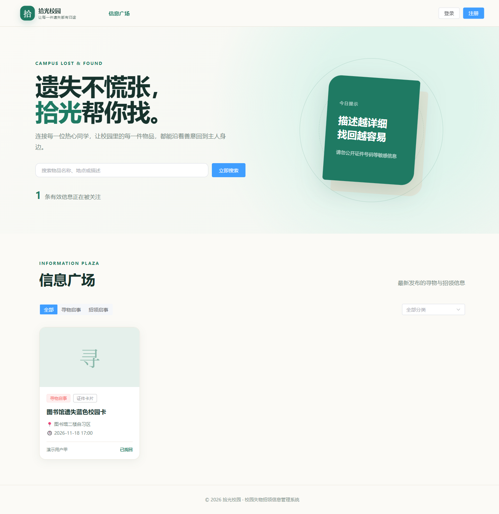
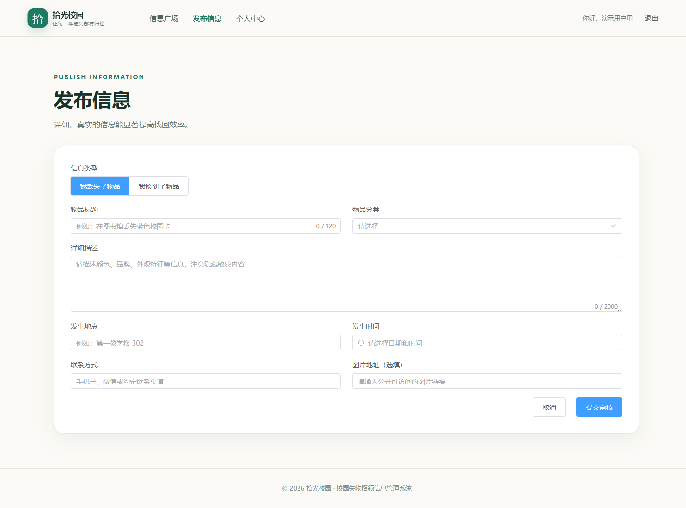
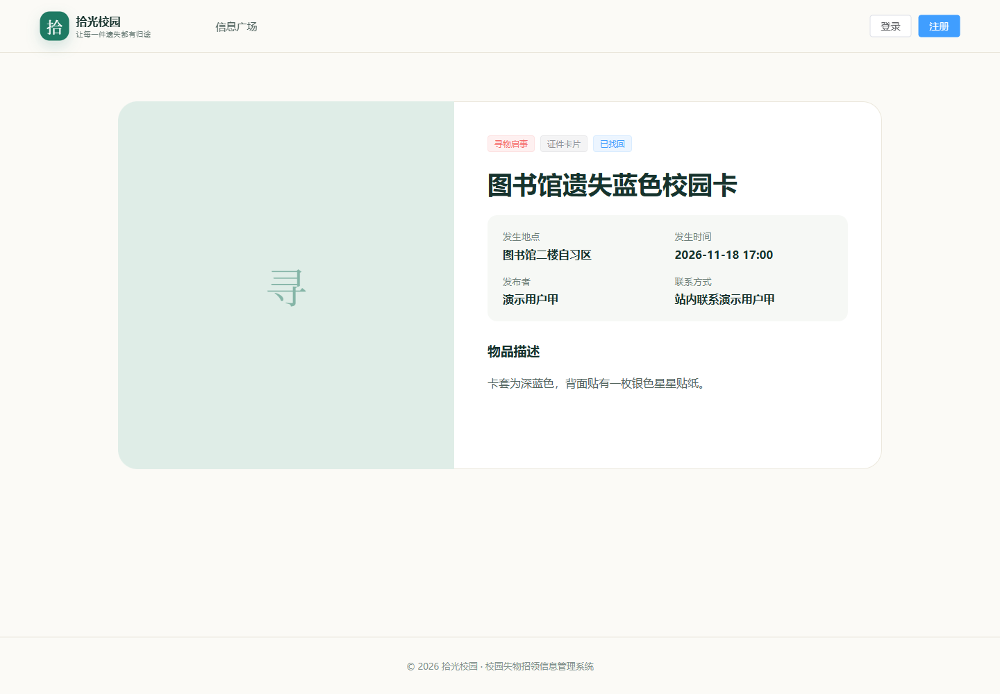
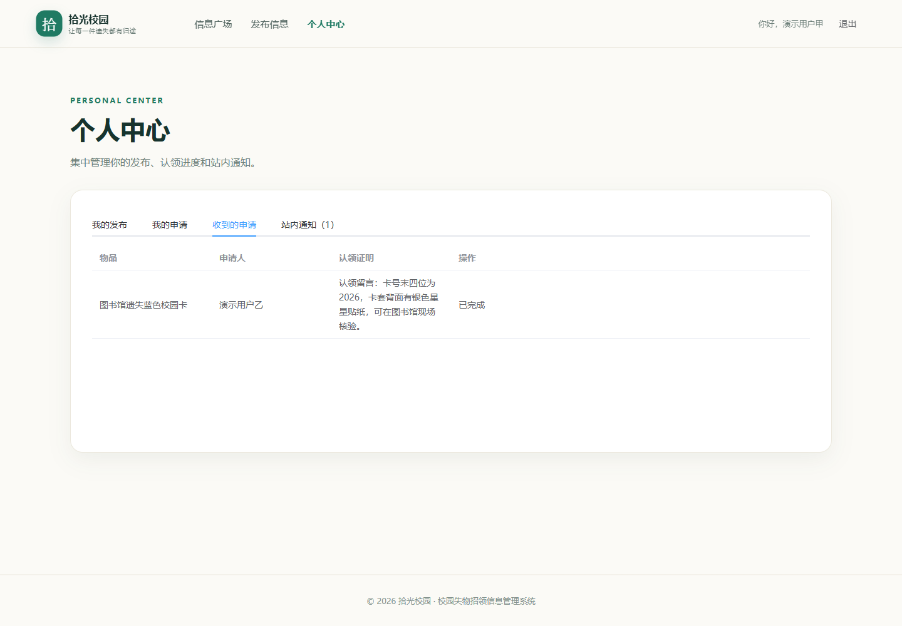
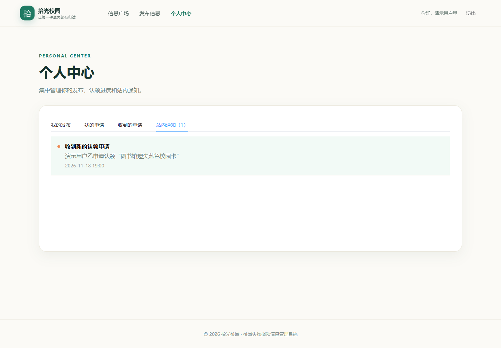
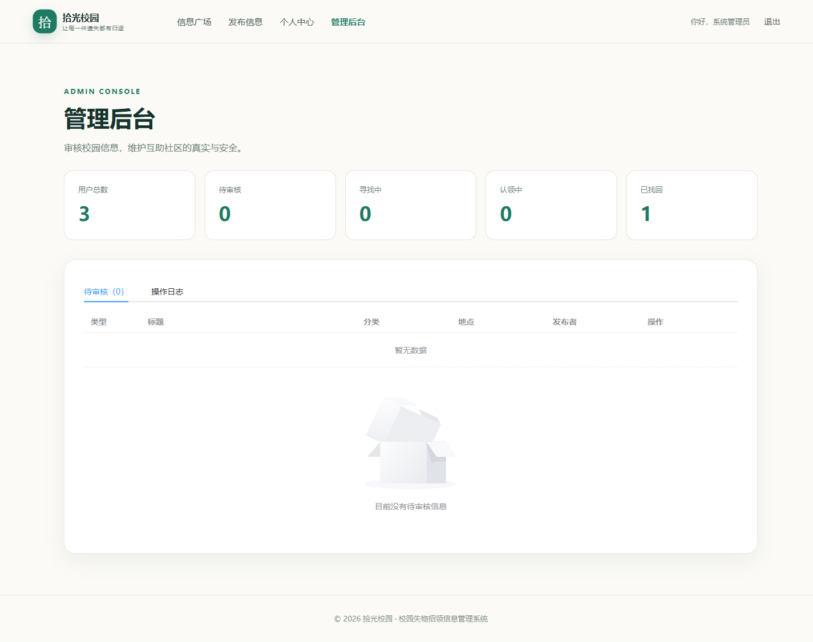
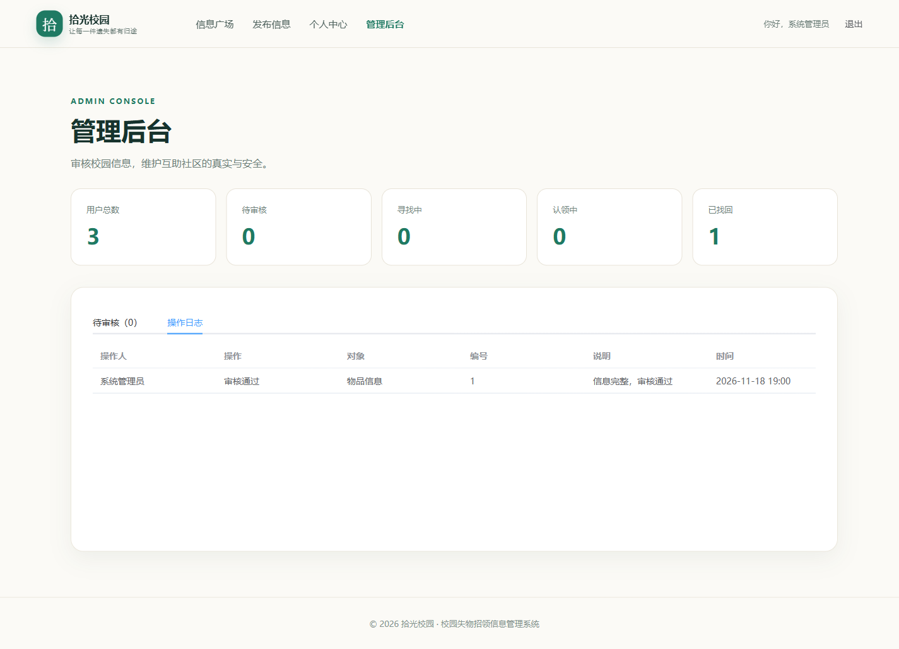

# 系统验收报告

## 验收概况

- 验收日期：2026 年 11 月 18 日
- 操作系统：Windows 11
- 后端环境：Java 17.0.11、Maven 3.8.8、Spring Boot 3.5.7
- 前端环境：Node.js 24.20.0、npm 11.19.0、Vue 3、Vite 7
- 数据库环境：MySQL 8.0.35 独立验收实例
- 浏览器：Playwright 管理的 Chromium

## 自动化测试结果

| 验证项目 | 命令 | 结果 |
|---|---|---|
| 后端单元与集成测试 | `mvn clean verify` | 9 项通过，0 失败，0 错误 |
| 前端测试 | `npm run test` | 3 项通过，0 失败 |
| 前端生产构建 | `npm run build` | 构建成功，1703 个模块完成转换 |

## 真实 MySQL 联调结果

数据库脚本成功创建 5 张业务表：`sys_user`、`item_post`、`claim_application`、`notification`、`operation_log`。Spring Boot 成功连接 MySQL 8.0.35，并完成管理员初始化。

| 编号 | 场景 | 预期结果 | 实际结果 |
|---|---|---|---|
| 1 | 两名普通用户注册并登录 | 返回用户信息与 JWT | 通过 |
| 2 | 用户甲发布寻物启事 | 状态为待审核 | 通过 |
| 3 | 管理员审核通过 | 状态变为寻找中，记录操作日志 | 通过 |
| 4 | 用户乙按关键字、类型和分类检索 | 命中目标信息 | 通过 |
| 5 | 用户乙提交认领留言 | 发布者收到申请与通知 | 通过 |
| 6 | 用户甲同意申请 | 申请变为已通过，信息进入认领中 | 通过 |
| 7 | 用户甲确认归还 | 申请变为已完成，信息变为已找回 | 通过 |
| 8 | 管理员查看统计与日志 | 统计数量正确，日志可查询 | 通过 |

本轮使用的演示数据最终统计：用户 3 名、待审核 0 条、寻找中 0 条、认领中 0 条、已找回 1 条。演示数据仅存在于本地验收数据库，不提交到仓库。

## 浏览器验收

浏览器逐页检查了登录、首页检索、信息详情、发布信息、个人中心、认领申请、站内通知和管理后台。浏览器控制台记录 0 个错误、0 个警告。

### 首页信息广场

### 发布信息

### 信息详情

### 收到的认领申请

### 站内通知

### 管理后台统计

### 管理员操作日志

## 验收结论

系统已在真实 MySQL 环境中完成核心业务闭环，后端测试、前端测试和生产构建均通过。当前功能满足系统设计说明中的首版验收标准，可用于毕业设计演示和后续论文整理。

