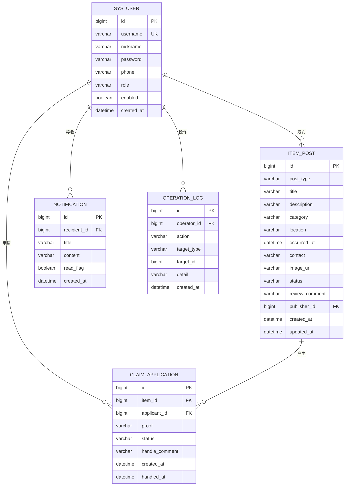

# 数据库设计

系统使用 MySQL 8，数据库名为 `campus_lost_found`，默认字符集为 `utf8mb4`。建表脚本位于 `database/schema.sql`。

## 实体关系图

## 表结构说明

| 表名 | 作用 | 关键约束 |
|---|---|---|
| `sys_user` | 保存普通用户和管理员 | `username` 唯一；密码保存 BCrypt 摘要 |
| `item_post` | 保存寻物和招领信息 | `publisher_id` 关联发布者；按状态和创建时间建立索引 |
| `claim_application` | 保存认领申请和处理结果 | 关联物品与申请人；按物品和状态建立索引 |
| `notification` | 保存站内通知 | 关联接收人；按接收人、已读状态和时间建立索引 |
| `operation_log` | 保存管理员审核日志 | 关联操作人；按创建时间建立索引 |

## 主要关系

- 一个用户可以发布多条失物或招领信息。
- 一条信息可以收到多条认领申请，每条申请只属于一个申请人。
- 一个用户可以接收多条站内通知。
- 管理员的审核行为写入操作日志，日志保存目标类型和目标编号。

## 数据安全

- 用户密码不保存明文，只保存 BCrypt 摘要。
- JWT 密钥和数据库密码通过环境变量提供，不写入数据表或仓库。
- 联系方式仅对系统页面展示，演示时不应使用真实敏感信息。
- 外键保证主要业务记录的引用完整性。

